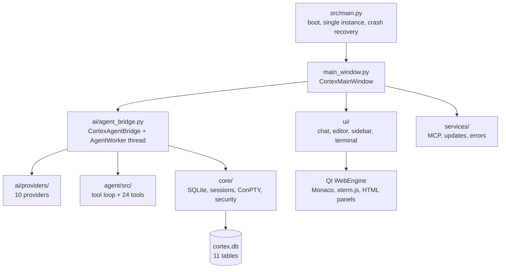

<div align="center">

# Cortex AI IDE

### An agentic workspace with a native code editor

Hand a task to an AI agent and watch it plan, read your code, edit files, run
commands and iterate until the work is done, inside a real IDE.

**Version 3.0.67** &nbsp;·&nbsp; Apache-2.0 &nbsp;·&nbsp; Windows 10 / 11 &nbsp;·&nbsp; Linux &nbsp;·&nbsp; macOS (source build)

[Website](https://cortex-ide.app/) &nbsp;·&nbsp; [Documentation](https://cortex-ide.app/docs/) &nbsp;·&nbsp; [Pricing](https://cortex-ide.app/pricing/) &nbsp;·&nbsp; [Issues](https://github.com/Cortex-AI-IDE/Cortex-Desktop/issues)

</div>

---

## Contents

- [What Cortex is](#what-cortex-is)
- [Appearance and accessibility](#appearance-and-accessibility)
- [Licence and scope](#licence-and-scope)
- [Requirements](#requirements)
- [Installation](#installation)
- [Why Node.js is required](#why-nodejs-is-required)
- [First run and API keys](#first-run-and-api-keys)
- [Project layout](#project-layout)
- [Architecture](#architecture)
- [Agent tools](#agent-tools)
- [Supported model providers](#supported-model-providers)
- [Troubleshooting](#troubleshooting)
- [Development](#development)
- [Licence](#licence)
- [Contributing](#contributing)

---

## What Cortex is

Cortex is a desktop code editor built around an autonomous agent rather than a
chat sidebar bolted onto an editor. The agent has its own tool loop: it can
search the project, read files, write and edit them, run shell commands in a
real terminal, fetch web pages, and check its own work with a verification
pass. You watch each step land in the transcript as it happens.

The application is a hybrid: a native PyQt6 shell for the window, splitters,
dialogs and process management, with Chromium (Qt WebEngine) hosting four rich
panels that would be painful to build natively:

| Panel | Technology |
|-------|------------|
| File explorer | `src/ui/html/sidebar.html` |
| Editor | Monaco Editor in `src/assets/editor.html` |
| Terminal | xterm.js in `src/ui/components/assets/xterm` |
| Chat transcript, memory manager, live preview | `src/ui/html/ai_chat`, `src/ui/html/memory_manager` |

### What it does

- **Agentic editing.** The agent works through a task with tools, not just
  suggestions. Every file write is shown as a reviewable diff.
- **Permission gates.** Destructive operations are gated before they run, with
  a rule system (exact match, wildcard) for the commands you trust.
- **Verified iteration.** A loop engine can run your tests, lint and build,
  then feed the failures back to the model until the checks pass.
- **Bring your own key.** Eight providers are supported natively. Keys are stored
  encrypted on your machine and never leave it except to the provider you chose.
- **Project memory.** Markdown memories in `~/.cortex/memory` carry decisions
  and preferences across sessions.
- **MCP support.** External Model Context Protocol servers load into the same
  tool loop.
- **Bundled skills.** PDF, Word, Excel, PowerPoint, test-driven development,
  browser testing and more, loaded on demand.
- **One theme everywhere.** Sixteen colour themes plus Cortex's own, applied to
  the native shell, the chat, the editor and the terminal at once, with two
  high-contrast and two colour-blind-safe variants. See
  [Appearance and accessibility](#appearance-and-accessibility).
- **Workspace trust.** Opening an unfamiliar folder asks first. Until you trust
  it, the folder runs in Restricted Mode with project MCP servers, project
  skills, venv activation and automatic git held back.

---

## Appearance and accessibility

Cortex has **one** theme setting: **Settings → Appearance → Color theme**. It
is not per-panel, so the window, the chat transcript, Monaco and the terminal
cannot drift apart.

| Group | Themes |
|-------|--------|
| Cortex | Cortex (Dark / Light / System), Cortex's own palette |
| Colour themes | Dark+ and Light+ (VS Code), One Dark Pro, Dracula, Monokai, GitHub Dark, GitHub Light, Night Owl, Tokyo Night, Catppuccin Mocha, Nord, Solarized Light |
| Accessibility | High Contrast Dark, High Contrast Light, Distinct Colors Dark, Distinct Colors Light |

The four accessibility themes sit in their own **Accessibility** group at the
bottom of the dropdown:

- **High Contrast Dark / Light** hold body text and every syntax colour at
  WCAG AAA (7:1) and switch Monaco to its `hc-black` / `hc-light` bases, so
  focus rings and selections get outlines instead of relying on colour alone.
- **Distinct Colors Dark / Light** use the Okabe-Ito palette. Anything that
  normally leans on red versus green, such as error versus success, git
  removed versus added, or terminal red versus green, becomes orange versus
  blue and stays readable with protanopia, deuteranopia or tritanopia.

Picking a theme also sets dark or light mode, so widgets that have no explicit
rule still match instead of showing a light gap in a dark window.

### Fonts

Inter (UI) and JetBrains Mono (code, terminal) ship in `src/assets/fonts/`
under the SIL Open Font License 1.1, with both licence texts alongside. There
is nothing to install. The fonts are registered twice on purpose: through
`QFontDatabase` for the native Qt widgets, and through `@font-face` in every
Qt WebEngine page, because Chromium cannot see fonts that Qt registered.

### Chat, editor and layout

| Setting | Where | Effect |
|---------|-------|--------|
| Chat activity | Settings → Appearance → Interface | **Compact** (default) folds the thoughts, commands, searches and edits between two messages into one collapsible line. **Detailed** keeps a card per step. Applies to new replies and to chats you reopen. |
| Sidebar position | Settings → Appearance → Interface | File explorer on the left or right, mirroring the VS Code layout. |
| Font size, font family | Settings → Appearance → Editor | The code editor updates live, not just on restart. |
| Tab size, word wrap, minimap | Settings → Appearance → Editor | Pushed to Monaco on load and while it is running. |
| Font size, font family, scrollback, cursor | Settings → Terminal → Appearance | The terminal updates live too. |

---

## Licence and scope

Cortex is released under the **Apache License 2.0**. See [LICENSE](LICENSE).

You may use, modify, redistribute and sell software built on this code,
including commercially, provided you keep the licence and copyright notices
and state what you changed. There is an explicit patent grant, and no
trademark rights are granted: do not present a modified build as the official
Cortex product. The full text of these terms is in [LICENSE](LICENSE).

### Binary distribution

Cortex's own source code is licensed under Apache-2.0. The desktop app links
PyQt6, which is licensed under GPL v3, so the compiled application as a whole
is distributed under the terms of GPL v3. Full source for every release is
available in this repository.

Payments, hosted services and third-party content are not part of that
combined work: they run as separate services or are bundled under their own
licences. See [THIRD-PARTY-NOTICES.md](THIRD-PARTY-NOTICES.md) for the full
list.

### What this repository contains

The desktop application source: the PyQt6 shell, the agent bridge, the
provider integrations, the agent runtime with its tools, the UI, the data
layer and the security modules. See [Project layout](#project-layout).

This is the complete source of the desktop application, so the **Cortex
desktop app side is fully open source** under the Apache License 2.0. You can
read it, build on it, modify it and redistribute it as described above.

### What this repository does not contain

| Not included | Why |
|--------------|-----|
| Build and packaging pipeline | The Windows Inno Setup installer script, the MSIX manifest and code signing configuration. The PyInstaller specs are included. |
| Hosted services | The account, billing and update-check backends run separately |
| `plugins/` | Not part of this release |
| Release binaries | Download the signed build from [cortex-ide.app](https://cortex-ide.app/) |

The remaining pieces are being prepared for release separately. Until that work
finishes, treat this as the source release of the desktop application: the app
source here is complete and open, while the components listed above are not part
of this repository yet.

---

## Requirements

| Requirement | Version | Notes |
|-------------|---------|-------|
| Platform | Windows 10 or 11 (64-bit), Linux, macOS 12+ | Windows runs the terminal in ConPTY and keeps keys in Credential Manager; Linux and macOS use the POSIX PTY in `src/core/pty_backend.py`. See [MACOS-PORT.md](MACOS-PORT.md) for the macOS build |
| Python | 3.11 or newer | 3.14 is what this release was built and tested on |
| Node.js | 18 or newer | Required for the editor and for MCP servers. See [below](#why-nodejs-is-required) |
| Git | any recent | To clone the repository |
| Disk space | about 2 GB | Chromium, Qt and the Python environment |
| RAM | 8 GB recommended | Four embedded Chromium panels are live at once |

`ripgrep` is **not** required. A copy ships in `bin/rg.exe` for Windows; on
Linux and macOS install it with your package manager if you want the fast path.
Without it the Grep tool falls back to a pure-Python search.

---

## Installation

Open **PowerShell** and work through these steps in order.

### 1. Install Python

```powershell
winget install --id Python.Python.3.12 -e
```

Or download the installer from [python.org](https://www.python.org/downloads/).
During installation, tick **Add python.exe to PATH**.

Verify it worked:

```powershell
python --version     # expect Python 3.11 or newer
```

### 2. Install Node.js

```powershell
winget install --id OpenJS.NodeJS.LTS -e
```

Or download the LTS installer from [nodejs.org](https://nodejs.org/). Accept
the default options, which add Node and npm to `PATH`.

Close and reopen PowerShell afterwards so `PATH` is refreshed, then verify:

```powershell
node --version       # expect v18 or newer
npm --version        # expect 9 or newer
```

### 3. Clone the repository

```powershell
git clone https://github.com/Cortex-AI-IDE/Cortex-Desktop.git
cd Cortex-Desktop
```

### 4. Install the JavaScript dependency

From the project root, the folder that now contains `package.json`:

```powershell
npm install
```

This creates `node_modules/` and pulls in **Monaco Editor**, the code editor
that the editor pane loads at runtime. Skip this step and the editor pane will
show `Monaco loader.js missing` instead of your code.

### 5. Create a virtual environment

A virtual environment keeps Cortex's dependencies out of your global Python.

```powershell
python -m venv .venv
.\.venv\Scripts\Activate.ps1
```

If PowerShell blocks the activation script, allow it for the current session
and try again:

```powershell
Set-ExecutionPolicy -Scope Process -ExecutionPolicy Bypass
.\.venv\Scripts\Activate.ps1
```

Your prompt should now start with `(.venv)`. Every command below assumes the
environment is active.

### 6. Install the Python dependencies

```powershell
python -m pip install --upgrade pip
python -m pip install -r requirements-dev.txt
```

`requirements-dev.txt` pulls in `requirements.txt` (the runtime) and adds the
development tooling: pytest, black, PyInstaller and the type stubs. This is the
file to install, whether you plan to develop or just run the app.

If you only want to run Cortex and not develop it, install the runtime alone:

```powershell
python -m pip install -r requirements.txt
```

There is also `requirements-lock.txt`, a full `pip freeze` of the exact
environment this release was built and tested in. Use it only when you need a
byte-exact reproduction:

```powershell
python -m pip install -r requirements-lock.txt
```

Installation takes a few minutes. Qt and PyQt6-WebEngine are the large ones.

### 7. Run Cortex

From the project root, with the virtual environment active:

```powershell
python src/main.py
```

The first launch is slower than later ones: Qt WebEngine has to unpack and
warm its profile. Give it ten or twenty seconds.

---

## Why Node.js is required

Node is not a build-time nicety here. Two runtime features need it.

**1. The editor pane.** Cortex injects Monaco's AMD loader into
`src/assets/editor.html` at startup. The loader is read from
`node_modules/monaco-editor/min/vs/loader.js`:

```python
_monaco_loader = _bundle_root / "node_modules" / "monaco-editor" / "min" / "vs" / "loader.js"
```

If that file is absent the pane renders an error instead of an editor. This is
the reason `npm install` is a mandatory step. The version is pinned to
`monaco-editor@0.52.2` in `package.json` on purpose: Cortex needs the AMD
`min/vs` build, which newer major lines are expected to drop.

**2. MCP servers.** Almost every Model Context Protocol server is published to
npm and started with `npx`, for example:

```json
{ "mcpServers": { "postgres": { "command": "npx", "args": ["-y", "@modelcontextprotocol/server-postgres"] } } }
```

Cortex resolves the Windows shim for you. On Windows npm installs `npx.cmd`
rather than `npx`, and `CreateProcess` does not consult `PATHEXT`, so Cortex
resolves `npx`, `uvx`, `bunx` and `pnpm dlx` itself before spawning. You can
write `"command": "npx"` in a server config and it will work.

Node is also used by the browser-testing skill (Playwright) and by projects you
open in Cortex, where the agent will run `npm test`, `npx tsc` or `npm run
build` in the integrated terminal. Those run in your project, not in Cortex.

What Node is **not** used for: the app's own UI assets. xterm.js and Mermaid
are vendored inside the repository, and the file explorer, chat transcript and
memory manager are plain HTML, CSS and JavaScript served from
`src/ui/html`. No bundler runs at startup.

---

## First run and API keys

Cortex ships with no credentials and no bundled model. You supply your own key
for whichever provider you want to use.

1. Launch Cortex and open **Settings** (the gear in the sidebar).
2. Go to the **Models** or **Providers** section.
3. Paste an API key for one of the providers listed below and pick a model.

The first time you open a folder, Cortex asks whether you trust it. Answering
**no** keeps it in Restricted Mode for as long as you have it open: venv
activation, the project's MCP servers, project skills, `.cortex` rules in the AI
prompt and automatic git are all held back, and commands and edits wait for
your approval one at a time. The **Restricted Mode** button in the status bar
tells you which state you are in and lets you change your mind later.

Where keys live:

| Location | Contents |
|----------|----------|
| `~/.cortex/settings.json` | Preferences, model selection, window state |
| Encrypted key store | API keys, encrypted with AES-GCM and a PBKDF2-derived key, managed by `src/core/key_manager.py` |

Keys are never written to the project folder and never committed. If a key is
ever found in `settings.json`, Cortex moves it into the encrypted store and
tells you to rotate it.

Useful paths:

| Path | What it holds |
|------|---------------|
| `~/.cortex/` | Settings, memories, rules, logs, semantic index |
| `~/.cortex/memory/` | Project and user memories, as Markdown |
| `~/.cortex/logs/` | `cortex.log`, the main diagnostic log |
| `~/.cortex/workspace_trust.json` | Which folders you trusted and which you declined |
| `~/.cortex/always_allow.json` | Folders you granted "always allow" permission edits for |
| `%LOCALAPPDATA%\Cortex\bin` | Cached `rg.exe` |

Both permission files live here rather than inside the project, so a repository
cannot grant itself access by shipping a file that looks like a saved answer.
Clearing either one is safe: Cortex simply asks again.

When something goes wrong, `~/.cortex/logs/cortex.log` is the first place to
look. Cortex writes stall reports there too: if the window freezes, the log
records how long it was frozen and the Python stack that was blocking, which
usually names the exact function.

---

## Project layout

```
Cortex-Desktop/
├── src/                     Application source (~206,000 lines, 779 Python files)
│   ├── main.py              Entry point, boot sequence, single-instance guard
│   ├── main_window.py       Main window, tabs, splitters, menus
│   ├── version.py           Single source of truth for the version
│   ├── assets/
│   │   ├── editor.html      Monaco host page
│   │   └── fonts/           Inter and JetBrains Mono, SIL OFL 1.1
│   ├── ai/                  Agent orchestration and model providers
│   │   ├── agent_bridge.py  The brain: message history, tool dispatch, streaming
│   │   ├── providers/       Provider integrations and the message serializers
│   │   ├── agent_safety.py  Directives that survive context compaction
│   │   ├── circuit_breaker.py, reasoning_loop.py   Runaway-loop guards
│   │   ├── mcp_context.py, mcp_guidance.py   MCP roots, snapshot pruning, usage hints
│   │   └── context/         Project context, skeletons, compaction
│   ├── agent/               Agent runtime (tools, skills, permissions, MCP)
│   │   ├── src/tools/       Bash, Read, Edit, Grep, Glob, WebFetch...
│   │   ├── src/skills/      Bundled skills (pdf, docx, xlsx, pptx, tdd...)
│   │   ├── src/services/    Compaction, session memory, MCP, analytics
│   │   └── src/utils/permissions/   The permission model that gates tool calls
│   ├── core/                Platform services
│   │   ├── database.py      SQLite schema and access
│   │   ├── pty_backend.py   One PTY interface: ConPTY on Windows, pty.fork elsewhere
│   │   ├── terminal_session.py   Shared shell session for the AI and the terminal panel
│   │   ├── workspace_trust.py, project_permissions.py   Trust and remember-access stores
│   │   ├── invocation_tokens.py   The skills:/mcp: tokens written into a prompt
│   │   ├── exit_hooks.py    Cleanup that runs even through os._exit
│   │   ├── semantic_search.py, embeddings.py, codebase_index.py
│   │   ├── loop_engine/     Verified iteration: verify, review, budget
│   │   ├── security_toolkit/  Recon, defense, web probe, reporting
│   │   └── git_manager.py, secure_http.py
│   ├── ui/                  PyQt6 widgets and the embedded web assets
│   │   ├── fonts.py         Registers the bundled fonts with Qt and WebEngine
│   │   ├── color_themes.py  The 16 colour themes for shell, chat and terminal
│   │   ├── editor_theme.py, theme_remap.py   Monaco themes, live theme remap
│   │   ├── editor_prefs.py  Tab size, word wrap, minimap
│   │   └── html/            Sidebar, chat transcript, memory manager
│   ├── services/            MCP manager, error taxonomy, update checker
│   ├── coordinator/         Multi-agent coordination
│   ├── config/              Settings, theme manager
│   └── utils/               Logging, diffs, icons, language detection
├── bin/
│   ├── rg.exe               Bundled ripgrep, used by the Grep tool
│   └── node/                Node.js copy used by packaged builds (not committed)
├── tools/                   Standalone maintenance scripts
├── package.json             Node dependency: monaco-editor
├── requirements.txt         Runtime Python dependencies
├── requirements-dev.txt     Runtime plus development tooling
├── requirements-lock.txt    Exact pip freeze of the build environment
├── cortex-macos.spec        PyInstaller spec for the macOS .app and .dmg
├── .github/workflows/       macos-build.yml: CI build, no Mac needed
└── MACOS-PORT.md            The macOS port: what changed and how to build it
```

---

## Architecture



The flow for one request:

1. You type a prompt. `chat_panel` emits it and `agent_bridge` takes over.
2. The bridge assembles context: project context, memories, rules, the tool
   schemas, and the conversation so far.
3. The provider streams back text and tool calls. Text is rendered live into
   the transcript as prose, thoughts and tool cards.
4. Each tool call is permission-checked, dispatched, and its result returned to
   the model, which decides the next step.
5. File writes are staged and shown as diffs for you to accept.
6. When the model stops calling tools, the turn ends and the transcript is
   persisted.

---

## Agent tools

The agent runtime ships with these tools:

| Category | Tools |
|----------|-------|
| Files | `Read`, `Write`, `Edit`, `NotebookEdit`, `Glob`, `Grep`, `SementicSearch` |
| Shell | `Bash`, `PowerShell`, `REPL` |
| Web | `WebSearch`, `WebFetch` |
| Task | `TodoWrite`, `Skill`, `Agent`, `SendMessage`, `AskUserQuestion` |
| Modes | `PlanBuild`, `EnterPlanMode`, `ExitPlanMode` |
| Utility | `Sleep`, `ToolSearch`, `VisionAgent`, `ListMcpResources` |

Every tool runs through `agent/src/utils/permissions/`. Read-only operations
pass through; writes, deletions and shell commands are gated by the permission
rules you configure, and irreversibly destructive shell commands are rewritten
to go through the Recycle Bin where possible.

---

## Supported model providers

### BYOK providers

These eight connect directly from your machine to the provider using your own
key. Your traffic does not pass through Cortex.

| Provider | Notes |
|----------|-------|
| Anthropic | Claude models |
| OpenAI | GPT and o-series |
| DeepSeek | DeepSeek models |
| Alibaba / DashScope | Including the separate Token Plan billing endpoint |
| Xiaomi MiMo | Note that token-plan (`tp-`) keys reject images; `sk-` keys do vision |
| OpenRouter | Aggregator, many models, including free tiers |
| InferenceHub | One key for many models |
| Google | Gemini models |

### Managed services

Two further integrations belong to the optional subscription rather than to
BYOK:

| Service | Used for |
|---------|----------|
| Mistral | OCR and vision fallback |
| SiliconFlow | Cloud embeddings |

Model limits, context windows and capability flags live in
`src/ai/model_limits.py` and `src/ai/model_registry.py`.

---

## Troubleshooting

**The editor pane says `Monaco loader.js missing`.**
You skipped `npm install`, or you ran it in the wrong folder. Run it in the
directory that contains `package.json`, then restart Cortex.

**`python` is not recognized.**
Python is not on `PATH`. Reinstall it with **Add python.exe to PATH** ticked,
or use the `py` launcher instead: `py -m pip install -r requirements-dev.txt`.
On Windows, prefer `python -m pip` over a bare `pip` so you install into the
running interpreter.

**Activating the virtual environment is blocked by PowerShell.**
Run `Set-ExecutionPolicy -Scope Process -ExecutionPolicy Bypass` first. This
applies to the current shell only.

**A provider returns 401.**
Check the key and the endpoint. The Alibaba Token Plan is the usual trap:
`sk-sp-` keys are a separate billing channel that needs the Token Plan
endpoint, and the standard endpoint rejects them.

**The window is blank or shows grey boxes.**
Qt WebEngine failed to start its render process, usually after an unclean exit.
Cortex clears stale profile locks and orphaned `QtWebEngineProcess.exe` on
startup. If it persists, close Cortex fully, delete `%LOCALAPPDATA%\Cortex`
and relaunch.

**The window stops responding during a long agent run.**
Large streaming payloads used to freeze the GUI thread. That path is bounded
now, but if it happens, `~/.cortex/logs/cortex.log` will contain a `UI-STALL`
entry naming the blocking function. Attach that to an issue.

**Grep is slow.**
Confirm `bin/rg.exe` is present. Without it, Cortex falls back to a pure-Python
search and says so in the result.

**Tools I did not expect to see.**
Ask the model for something the skills do not cover. Skills load on demand
rather than all at once, so the first request for one is slower.

**Cortex keeps asking to allow the same folder.**
A one-off "allow" lasts only until the app closes. Choose **Allow always** to
record it in `~/.cortex/always_allow.json`, or use the switch in the status bar
to revoke every grant. Nothing is recorded while the folder is in Restricted
Mode.

**A project's MCP servers or skills did not load.**
Check the status bar: if it says **Restricted Mode**, trust the folder. Project
MCP servers, project skills and `.cortex` rules are all deliberately held back
until you do, because each of them is code or instructions from the repository.

**The interface uses Segoe UI instead of Inter.**
The bundled fonts failed to register, which usually means `src/assets/fonts/` is
missing or was not copied into a packaged build. The app still works, it just
falls back to the system font. `~/.cortex/logs/cortex.log` says which one it
was: `[Fonts] missing bundled font`, `[Fonts] Qt could not load`, or
`[Fonts] registered with Qt` when it worked.

**Half the window kept the old colours after switching theme.**
A theme should reach all four surfaces at once. If one lags behind, the log
records `color_themes` activity; restarting re-applies the saved theme from
scratch and is the quickest way to confirm whether the theme itself is broken.

**Text is hard to read against a dark background.**
Switch to **High Contrast Dark** or **Distinct Colors Dark** in Settings →
Appearance. The first raises every text and syntax colour to WCAG AAA, the
second replaces red-versus-green distinctions with orange-versus-blue for
colour vision deficiency.

---

## Development

### Running from source

```powershell
.\.venv\Scripts\Activate.ps1
python src/main.py
```

There is no hot reload. A source change needs a full restart.

### Formatting

The project uses black:

```powershell
python -m black src
```

### Maintenance scripts

| Script | Purpose |
|--------|---------|
| `tools/gen_model_inventory.py` | Regenerates the model capability table |
| `tools/compact_timeline_db.py` | Repairs oversized stored diffs in the chat database |

### Notes for contributors

- The version lives only in `src/version.py`. Do not hardcode it elsewhere.
- There is one theme setting, not one per panel. A new surface should read its
  colours from `src/ui/color_themes.py` rather than defining its own, or it will
  be the one grey panel when someone picks Dracula.
- Anything that streams should use `time.monotonic()`, never `time.time()`. A
  wall-clock correction on 2026-10-15 jumped forward by over three hours and two
  healthy requests were abandoned as "no data for hours".
- GUI handlers must not do unbounded work on streamed content. A single agent
  run can emit multi-megabyte payloads, and any `re.findall` or `"".join()` over
  one of them on the GUI thread will freeze the window. Cap first, then process.
- Work that must survive `os._exit` belongs in `src/core/exit_hooks.py`. Do not
  reach for `atexit` there: `atexit._run_exitfuncs()` also runs PyQt's hooks and
  segfaults on the way out.
- Prefer editing files through the Edit and Write paths in the app so line
  endings and encodings are preserved.
- The chat transcript is rendered live from streaming signals. The rendered
  cards are not stored in the database, only the final prose is, so a rendering
  bug will not be visible in the data.

---

## Licence

Copyright 2026 Cortex AI IDE.

Licensed under the Apache License, Version 2.0. You may obtain a copy of the
licence in the [LICENSE](LICENSE) file, or at:

https://www.apache.org/licenses/LICENSE-2.0

Unless required by applicable law or agreed to in writing, software distributed
under the licence is distributed on an "AS IS" BASIS, WITHOUT WARRANTIES OR
CONDITIONS OF ANY KIND, either express or implied. See the licence for the
specific language governing permissions and limitations under it.

The Cortex name and logo are trademarks. The licence does not grant permission
to use them, so a modified build must not be presented as the official Cortex
product.

---

## Contributing

Contributions are welcome. See [CONTRIBUTING.md](CONTRIBUTING.md) for the
workflow, then:

1. Fork the repository and create a branch: `git checkout -b feature/my-change`
2. Make your change and format it with black
3. Commit with a message that explains why, not just what
4. Push the branch and open a pull request

For a bug report, include the version from `src/version.py` and the relevant
lines from `~/.cortex/logs/cortex.log`.

---

<div align="center">

**Cortex AI IDE** · Think Limitless. Build Beyond.

</div>
